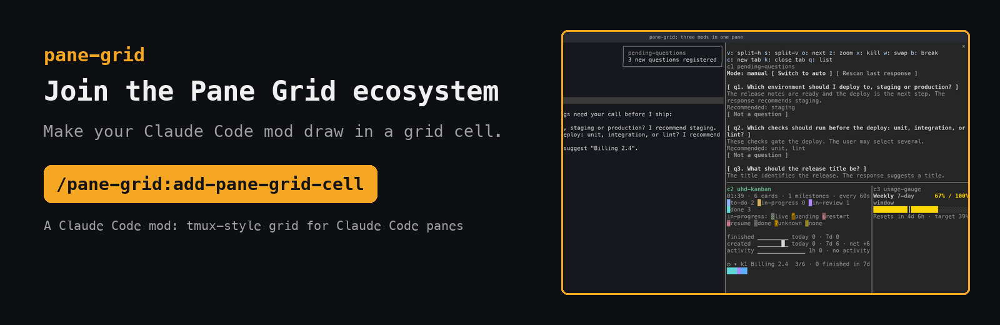
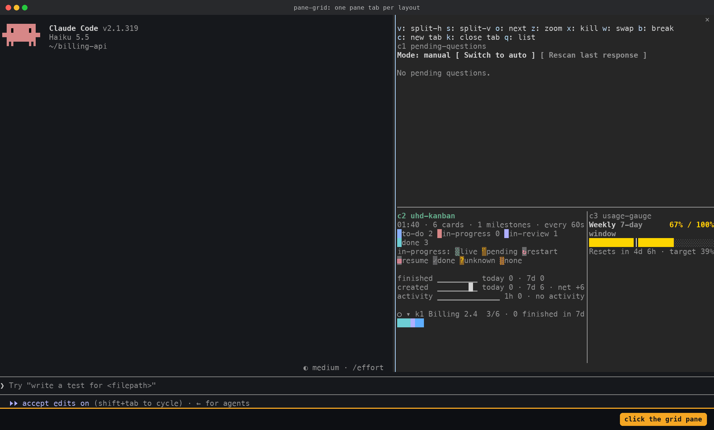
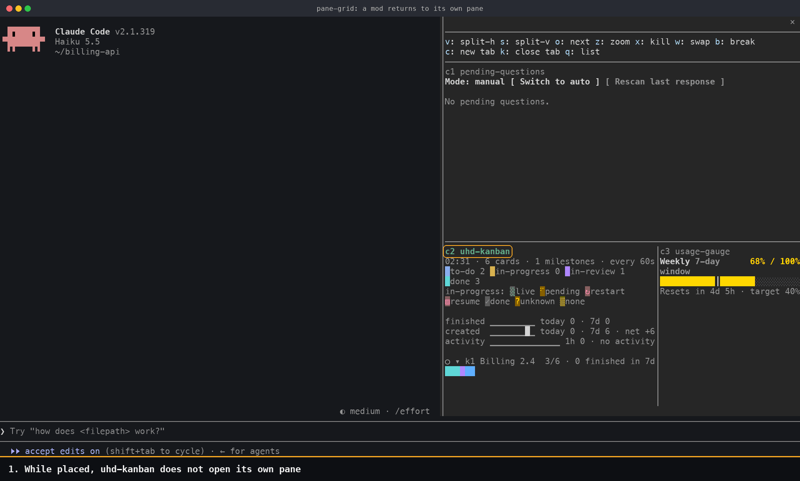

<a href="docs/add-pane-grid-cell.md"></a>

> [!TIP]
> **Join the Pane Grid ecosystem.** Any Claude Code mod can draw in a pane-grid cell. Open Claude Code in your mod's repository and paste the [prompt with this repository's address](#how-do-i-make-my-claude-code-mod-grid-ready): Claude installs pane-grid from `https://github.com/hwanyong/pane-grid`, runs **`/pane-grid:add-pane-grid-cell`** and applies the [grid-ready guide](docs/add-pane-grid-cell.md) to your code. Then [add your mod to the list](#which-claude-code-mods-are-grid-ready).

> [!IMPORTANT]
> **Want a mod in a cell that isn't grid-ready yet? Don't wait for its author.** Fork the mod's repository, open Claude Code in your fork and paste the [same prompt](#how-do-i-make-my-claude-code-mod-grid-ready). Push the change, then install the mod from your fork with `/plugin install <mod> --marketplace <your-account>/<repository>` (add `#<branch>` for a branch). If the original is already installed, remove its marketplace first, since the fork's marketplace has the same name. **Then tell me about it in [issue #1](https://github.com/hwanyong/pane-grid/issues/1)** and I'll add it to [the grid-ready list](#which-claude-code-mods-are-grid-ready) so everyone can use it.

# pane-grid: a Claude Code mod that splits a Claude Code pane into a tmux-style grid

[](LICENSE)
[](.claude-plugin/plugin.json)
[](https://github.com/anthropics/claude-code)

**pane-grid is a Claude Code mod (a plugin with a hooks module) that shows several Claude Code mods side by side in one pane.** Claude Code shows one mod pane at a time and puts the rest in tabs. pane-grid opens one pane, splits it into cells the way tmux splits a window, and lets each grid-ready mod draw in its own cell. Splits, resizing, zoom, swap, layout presets and layout tabs work from `/grid` commands and single-key hotkeys, and each project's layout is saved under `~/.claude/pane-grid/projects/`.


*Recorded from a real Claude Code session. See [About the recordings](#about-the-recordings).*

## Contents

- [Why use pane-grid?](#why-use-pane-grid)
- [Features](#features)
- [How do I install it?](#how-do-i-install-it)
- [How do I split a pane and place a mod?](#how-do-i-split-a-pane-and-place-a-mod)
- [How do I resize, zoom and rearrange cells?](#how-do-i-resize-zoom-and-rearrange-cells)
- [How do layout tabs work?](#how-do-layout-tabs-work)
- [What happens to a mod's own pane?](#what-happens-to-a-mods-own-pane)
- [Command and hotkey reference](#command-and-hotkey-reference)
- [Where is the layout saved?](#where-is-the-layout-saved)
- [Which Claude Code mods are grid-ready?](#which-claude-code-mods-are-grid-ready)
- [How do I make my Claude Code mod grid-ready?](#how-do-i-make-my-claude-code-mod-grid-ready)
- [How does it work?](#how-does-it-work)
- [Limitations](#limitations)
- [FAQ](#faq)
- [About the recordings](#about-the-recordings)
- [Development](#development)

## Why use pane-grid?

Claude Code mods draw panes beside the chat: a kanban board, the questions Claude asked you, rate-limit gauges. With several mod panes open, Claude Code shows one and turns the others into tabs, so you switch tabs to read the next one. pane-grid puts them in one pane at the same time, in the arrangement you choose, and keeps a separate layout per tab for different tasks.

## Features

| Feature | What it does | Demo |
|---|---|---|
| tmux-style splits | Split the active cell left-right (`v`) or top-bottom (`s`), to any depth | [Split and place](#how-do-i-split-a-pane-and-place-a-mod) |
| Mod picker in empty cells | An empty cell lists the grid-ready Claude Code mods that are loaded. A digit or a click places one | [Split and place](#how-do-i-split-a-pane-and-place-a-mod) |
| Drag to resize | Cells have no borders; a one-cell divider sits between them. Drag a divider with the mouse to resize the cells on both sides | [Arrange](#how-do-i-resize-zoom-and-rearrange-cells) |
| Click to focus | Click anywhere in a cell to make it active. The grid pane takes the keyboard, so hotkeys work right away | [Split and place](#how-do-i-split-a-pane-and-place-a-mod) |
| Presets | `/grid layout` applies `even-horizontal`, `even-vertical`, `main-vertical`, `main-horizontal` or `tiled`. `/grid resize <1-99>` sets a share from the prompt | [Arrange](#how-do-i-resize-zoom-and-rearrange-cells) |
| Zoom, next, swap | `z` draws the active cell alone, `o` moves to the next cell, `w` swaps two cells | [Arrange](#how-do-i-resize-zoom-and-rearrange-cells) |
| Layout tabs | Each layout is a Claude Code pane tab. `c` opens one, `b` breaks a cell out into one, `k` closes one | [Tabs](#how-do-layout-tabs-work) |
| Scroll per cell | The mouse wheel scrolls the cell under the pointer; page keys scroll the active cell. A mod that scrolls its own rows under a fixed header keeps doing so in its cell ([Step 7 of the guide](docs/add-pane-grid-cell.md#step-7-scroll-your-own-rows-in-the-cell-optional)) | [Overview](#pane-grid-a-claude-code-mod-that-splits-a-claude-code-pane-into-a-tmux-style-grid) |
| One place per mod | A placed mod stops drawing in its own pane or band, and returns there when its cell is emptied | [Own pane](#what-happens-to-a-mods-own-pane) |
| Saved layout per project | Each project keeps its own layout, restored in every new Claude Code session there. Worktrees and subfolders of a repository share it | [Layout file](#where-is-the-layout-saved) |
| Skill for mod authors | `/pane-grid:add-pane-grid-cell` makes another Claude Code mod grid-ready. Claude also opens it without being asked when it creates a mod, or adds or changes a pane or a band above the prompt in one, and applies it to a mod that draws a pane or a band | [Make a mod grid-ready](#how-do-i-make-my-claude-code-mod-grid-ready) |

## How do I install it?

pane-grid is a Claude Code mod, so it needs a Claude Code version with mods (tested on 2.1.319). At the Claude Code prompt:

```
/plugin install pane-grid --marketplace hwanyong/pane-grid
```

In a shell:

```
claude plugin install pane-grid --marketplace hwanyong/pane-grid
```

Restart Claude Code. pane-grid opens a pane tab named `main`. It holds one empty cell until you place a mod; install at least one [grid-ready mod](#which-claude-code-mods-are-grid-ready) to fill it.

Install order does not matter: pane-grid and grid-ready mods draw the same grid whichever loads first (pane-grid 0.3.0 and mods with its 0.3.0 [`hooks/pane-grid.ts`](skills/add-pane-grid-cell/pane-grid.ts)).

## How do I split a pane and place a mod?


1. Click a cell. It becomes the active cell (its title turns green) and the grid pane takes the keyboard, so hotkeys work. The first click on a cell that is not active only activates it; a Button under the pointer is pressed by the next click.
2. An empty cell lists the grid-ready mods that are loaded. In the active cell each has a digit: press it, or click the name, to place that mod.
3. Press `v` to split the active cell left and right, or `s` to split it top and bottom. The new cell becomes active and lists the mods again.
4. A mod is in one cell at a time. A mod that is already placed is listed as `(move from c1)`; picking it moves it.

The same actions are `/grid split -h`, `/grid split -v` and `/grid place <mod> [<cell>]` at the prompt. `/grid split -h uhd-kanban` splits and places in one step.

## How do I resize, zoom and rearrange cells?


- Drag the divider between two cells (`│` between left and right, `─` between top and bottom) to resize both. The new sizes are saved when you release the button.
- `/grid resize 35` gives the active cell 35% of its parent split.
- `/grid layout <preset>` rebuilds the tab's cells, in their current order, into a tmux preset: `even-horizontal`, `even-vertical`, `main-vertical`, `main-horizontal` or `tiled`.
- `z` (or `/grid zoom`) draws the active cell over the whole pane; press it again to restore the grid. The tab title shows `[Z]` while zoomed.
- `o` makes the next cell active, `w` swaps the active cell with the next one, and `x` removes the active cell.

## How do layout tabs work?



Each layout is one Claude Code pane tab with the id `grid-<name>`. Switching tabs is Claude Code's own tab switching (click a name in the tab bar), and `/grid select <name>` shows a tab from the prompt. When a different tab is shown, focus returns to the prompt; click a cell again before using hotkeys.

- `c` (or `/grid new [<name>]`) opens a layout tab with one empty cell. Claude Code opens it behind the tab you are on: click its name in the tab bar to show it.
- `b` (or `/grid break`) moves the active cell to a new tab.
- `k` (or `/grid close`) closes the current tab. The last tab stays.
- `/grid rename <name>` renames it, and `q` (or `/grid list`) prints every tab and cell.

A hidden tab is not drawn. A mod that runs an animation stops it while its tab is hidden (see [Step 6 of the guide](docs/add-pane-grid-cell.md#step-6-stop-timers-while-the-grid-tab-is-hidden-optional)).

## What happens to a mod's own pane?



A grid-ready mod draws in one place. While it has a cell, it closes its own pane (uhd-kanban, pending-questions, the Files tab of filetree) or stops drawing its band above the prompt (usage-gauge). `/grid place -` empties the active cell, and the mod opens its own pane or band again. Without pane-grid installed, every grid-ready mod works as it did before.

## Command and hotkey reference

Hotkeys work while the grid pane has focus. Commands work at the Claude Code prompt.

| Hotkey | Command | Action |
|---|---|---|
| `v` | `/grid split -h [<mod>]` | Split the active cell left and right |
| `s` | `/grid split -v [<mod>]` | Split the active cell top and bottom |
| `1`-`9` | `/grid place <mod> [<cell>]` | Place a mod (digits: in the active empty cell) |
| - | `/grid place - [<cell>]` | Empty a cell |
| `o` | `/grid next` | Make the next cell active |
| - | `/grid select-cell <cell>` | Make that cell active (or click anywhere in the cell) |
| `w` | `/grid swap [<cell>]` | Swap the active cell with the next cell or that cell |
| `z` | `/grid zoom` | Zoom the active cell, or restore |
| `x` | `/grid kill` | Remove the active cell |
| - | `/grid resize <1-99>` | Set the active cell's share in percent |
| - | `/grid layout <preset>` | Apply a tmux preset |
| `c` | `/grid new [<name>]` | Open a layout tab |
| - | `/grid select <name>` | Show a layout tab |
| - | `/grid rename <name>` | Rename the current tab |
| `k` | `/grid close` | Close the current tab |
| `b` | `/grid break` | Move the active cell to a new tab |
| `q` | `/grid list` | Print the tabs and cells |
| - | `/grid reload` | Read this project's layout file again |

`/grid help` prints the same list. tmux users: `v` and `s` replace tmux's `%` and `"`, which a Claude Code Button hotkey cannot use.

## Where is the layout saved?

In `~/.claude/pane-grid/projects/<name>/layout.json`, one file per project, written after every change and read when a Claude Code session starts and again after `/clear`. You can edit it and run `/grid reload`. If `CLAUDE_CONFIG_DIR` is set, the folder is `$CLAUDE_CONFIG_DIR/pane-grid/` instead of `~/.claude/pane-grid/`. When `$CLAUDE_CONFIG_DIR/pane-grid/layout.json` does not exist, pane-grid reads `~/.claude/pane-grid/layout.json` (where 0.4.x saved the layout) as the starting layout and does not write to it.

| Question | Answer |
|---|---|
| What is a project? | The main working tree of the git repository the session started in. A session started in a subfolder or in a worktree of that repository uses the same file. Outside git, it is the folder the session started in |
| What is `<name>`? | The project folder's last name and the first 16 hex digits of the SHA-256 of its path, for example `pane-grid-1a2b3c4d5e6f7a8b`. The file also holds the full path as `"project"` |
| A project without a file | pane-grid reads `~/.claude/pane-grid/layout.json`. Your first change writes the project file; `~/.claude/pane-grid/layout.json` is never written and stays the starting layout for new projects |
| `/cd` or a worktree move | pane-grid detects the new folder within a second, loads that project's layout and shows a toast |
| Two sessions in one project | Before writing, pane-grid checks that the file has not changed since it last read or wrote it. If another session changed it, pane-grid does not write, loads the file again and prints `refused: another session changed this project's layout`; do the change once more |

```json
{
  "version": 1,
  "project": "/Users/you/code/my-app",
  "tabs": [
    {
      "name": "main",
      "root": {
        "kind": "column",
        "children": [
          { "node": { "kind": "cell", "id": "c1", "plugin": "pending-questions" }, "size": 50 },
          { "node": { "kind": "row", "children": [
            { "node": { "kind": "cell", "id": "c2", "plugin": "uhd-kanban" }, "size": 60 },
            { "node": { "kind": "cell", "id": "c3", "plugin": "usage-gauge" }, "size": 40 }
          ] }, "size": 50 }
        ]
      },
      "active": "c2"
    }
  ]
}
```

`project` is only for you to read; pane-grid does not use it when reading. `row` places children left to right and `column` top to bottom. `size` is a share of the parent; sizes are scaled to add up to 100. A file that breaks the rules (a duplicate cell id or tab name, a mod in two cells) is not used: pane-grid starts with one empty tab, shows a toast with the reason, and keeps the file as `layout.invalid.json` in the project folder before its first write.

## Which Claude Code mods are grid-ready?

| Mod | What it draws in a cell | Install |
|---|---|---|
| [filetree](https://github.com/hwanyong/claude-code-filetree/tree/pane-grid-cell) | The project's file tree with its preview split. Clicks, keys and the wheel work in the cell. This is a fork branch; the change is proposed upstream in [data-goblin/claude-code-filetree#71](https://github.com/data-goblin/claude-code-filetree/pull/71). If filetree is installed from data-goblin, run `/plugin marketplace remove claude-code-filetree` first, since both marketplaces are named `claude-code-filetree` | `/plugin install filetree --marketplace hwanyong/claude-code-filetree#pane-grid-cell` |
| [flightdeck](https://github.com/hwanyong/claude-flightdeck/tree/pane-grid-cell) | Live agent dashboard: main model vitals, permission checks, subagent cards, turn receipt and session log. Hotkeys work in the active cell. This is a fork branch; the change is proposed upstream in [scasella/claude-flightdeck#34](https://github.com/scasella/claude-flightdeck/pull/34). If Flightdeck is installed from scasella, run `/plugin marketplace remove claude-flightdeck` first, since both marketplaces are named `claude-flightdeck` | `/plugin install flightdeck --marketplace hwanyong/claude-flightdeck#pane-grid-cell` |
| [inbox](https://github.com/hwanyong/inbox/tree/pane-grid-cell) | The items Claude surfaced for your decision, in Asks, Finds and PRs tabs. While inbox is placed, its band above the prompt is hidden. This is a fork branch; the change is proposed upstream in [petekp/inbox#376](https://github.com/petekp/inbox/pull/376). If inbox is installed from petekp, run `/plugin marketplace remove inbox` first, since both marketplaces are named `inbox` | `/plugin install inbox --marketplace hwanyong/inbox#pane-grid-cell` |
| [md-preview](https://github.com/hwanyong/claude-code-mods/tree/pane-grid-cell/mods/md-preview) | The Markdown files Claude edits, rendered, with Prev, Next, Before, Render, Text and Browser buttons. Only the text view was checked in a cell. This is a fork branch; the change is proposed upstream in [hamzafer/claude-code-mods#180](https://github.com/hamzafer/claude-code-mods/pull/180). If md-preview is installed from hamzafer, run `/plugin marketplace remove claude-code-mods` first, since both marketplaces are named `claude-code-mods`; this also removes the other mods installed from that marketplace | `/plugin install md-preview --marketplace hwanyong/claude-code-mods#pane-grid-cell` |
| [pending-questions](https://github.com/hwanyong/pending-questions) | The questions Claude asked you, with buttons that answer them | `/plugin install pending-questions --marketplace hwanyong/pending-questions` |
| [terminal-browser](https://github.com/hwanyong/terminal-browser/tree/pane-grid-cell) | A Chromium page drawn with the kitty graphics protocol; the wheel over the cell scrolls the page. The image in a cell was not checked, since the test ran inside tmux, where the mod draws no image. This is a fork branch; the change is proposed upstream in [zenbu-labs/terminal-browser#270](https://github.com/zenbu-labs/terminal-browser/pull/270). If terminal-browser is installed from zenbu-labs, run `/plugin marketplace remove terminal-browser` first, since both marketplaces are named `terminal-browser` | `/plugin install terminal-browser --marketplace hwanyong/terminal-browser#pane-grid-cell` |
| [uhd-kanban](https://github.com/hwanyong/skill-kanban) | A kanban board of the project's cards, with animated card moves | `/plugin install uhd-kanban --marketplace hwanyong/skill-kanban` |
| [usage-gauge](https://github.com/hwanyong/usage-gauge) | Session and weekly rate-limit gauges with a pace marker | `/plugin install usage-gauge --marketplace hwanyong/usage-gauge` |

Made a mod grid-ready, your own or a fork? Open a pull request that adds a row to this table, or post the link in [issue #1](https://github.com/hwanyong/pane-grid/issues/1) and I'll add it.

## How do I make my Claude Code mod grid-ready?

A grid-ready mod adds one `ui.render` hook for the grid pane, draws its content in a `Box` keyed `cell:<mod name>`, and steps out of its own pane while it is placed. It keeps working without pane-grid. Two ways to get there:

| Way | How |
|---|---|
| Let Claude do it | Open Claude Code in your mod's repository and paste the prompt below. It names this repository, installs pane-grid and runs the skill `/pane-grid:add-pane-grid-cell`, which copies the reading module, adds the hooks your mod needs, runs `claude plugin validate`, and lists what to check in a live session. It does not commit |
| By hand | Follow [docs/add-pane-grid-cell.md](docs/add-pane-grid-cell.md): eight steps with code, from copying [`hooks/pane-grid.ts`](skills/add-pane-grid-cell/pane-grid.ts) to the live check |

Prompt to paste into Claude Code, opened in your mod's repository:

```text
Make this Claude Code mod grid-ready for pane-grid: https://github.com/hwanyong/pane-grid
1. Install pane-grid: claude plugin install pane-grid --marketplace hwanyong/pane-grid
2. Run the skill /pane-grid:add-pane-grid-cell in this repository.
   If the skill is not loaded in this session, follow the guide instead:
   https://github.com/hwanyong/pane-grid/blob/main/docs/add-pane-grid-cell.md
   and copy https://github.com/hwanyong/pane-grid/blob/main/skills/add-pane-grid-cell/pane-grid.ts
   to hooks/pane-grid.ts without editing the exports you keep.
Do not commit. List what you changed and what I should check in a live session.
```

The skill was tested on a sample pane mod: it applied the guide, `claude plugin validate` and `tsc` passed, and the mod drew in a cell and returned to its own pane in a live session ([diff](verification/logs/skill-tool-calls.diff)).

## How does it work?

- The Claude Code mod engine has no API that splits a pane or draws one mod inside another mod's pane. pane-grid opens its own pane per layout and draws the cell tree with `Box` elements, a one-cell divider between cells.
- Every grid-ready mod hooks `ui.render` for panes whose id starts with `grid-` and that pane-grid opened (`{ component: 'Pane', requestId: /^grid-/, plugin: 'pane-grid' }`; Claude Code 2.1.325 and later call a render hook without `plugin` only for panes its own mod opened). A mod that loads after pane-grid appends a `Box` keyed `cell:<mod name>` to the tree, and pane-grid takes it into its cell. A mod that loads before pane-grid receives pane-grid's finished grid and puts its content into the `Box` keyed `slot:<mod name>` that pane-grid drew for it. Either way each mod's Buttons stay its own and keep working.
- The dividers and the click-to-focus areas are `Client` regions (Claude Code's surface modules). A drag or click is sent to pane-grid's `ui.message` hook, which writes the new layout.
- pane-grid publishes the layout and each cell's size in Claude Code's `$.state`. A mod reads its size there and redraws when the layout changes.
- The mod picker in an empty cell lists the mods beneath pane-grid from `next.trace` of the grid render, and each grid-ready mod above pane-grid adds its own Button to the `Box` keyed `choices:<cell>`. pane-grid's `ui.press` hook answers every `place:<cell>:<mod>` Button; its matcher has `plugin: '*'` because Claude Code 2.1.325 dispatches a press with the name of the mod that drew the Button.

The design notes, engine measurements and test runs are in [docs/grid-and-tabs.md](docs/grid-and-tabs.md) and [docs/direction.md](docs/direction.md) (Korean).

## Limitations

- Only grid-ready mods can be placed. The Claude Code mod engine does not let one mod draw another mod's pane with its Buttons working, so a mod has to opt in.
- A click on a cell that is not active only activates it. The engine passes no click on a mod's text to any hook, so pane-grid covers inactive cells to catch the click; the Button under the pointer is pressed by the next click.
- Dragging dividers and clicking to focus need the terminal: other surfaces have no `Client` regions, so there the dividers are plain lines and `/grid resize` · `/grid select-cell` do the same.
- The pane's width is Claude Code's: a mod pane takes up to 45% of the terminal, so wide layouts need a wide terminal.
- The mod picker lists every installed mod whose `ui.render` hook runs for the grid pane. A mod that is not grid-ready but hooks the grid pane with `plugin: 'pane-grid'` or `plugin: '*'` shows up too, and its cell reads `<mod> draws nothing here`. With Claude Code 2.1.322 a mod that hooked every `ui.render` without a matcher showed up the same way.
- A grid-ready mod that calls the reading module's `readPlacement` or `readShownTab` loads in Claude Code 2.1.299 or later. A mod that supports an older engine reads pane-grid's state in its own hooks file instead, as [Engine floor](docs/add-pane-grid-cell.md#engine-floor-claude-code-21299) in the guide shows.
- Tested in the terminal on macOS. The desktop and IDE surfaces were not tested.

## FAQ

### What is pane-grid?

pane-grid is a free, MIT-licensed Claude Code mod that splits one Claude Code pane into a tmux-style grid and shows several grid-ready mods in it at once.

### Can Claude Code show several mod panes at the same time?

Not by itself: Claude Code shows one mod pane and puts the others in tabs. With pane-grid, the mods share one pane in a grid, and each layout is a tab.

### Is pane-grid made by Anthropic?

No. It is a community Claude Code mod. Claude and Claude Code are products of Anthropic.

### Does pane-grid use my Claude usage?

No. pane-grid makes no model calls. It draws, reads and writes its layout files under `~/.claude/pane-grid/` and handles hotkeys.

### Why does a cell say a mod is not loaded?

The cell reads `<mod> is not loaded, its ui.render matcher lacks plugin: 'pane-grid', or its hooks/pane-grid.ts is older than pane-grid 0.3.0`. There are three causes:

- The mod is not installed or is disabled. Install or enable it.
- Its grid render hook's matcher has no `plugin: 'pane-grid'`. From Claude Code 2.1.325 that hook is never called for a grid pane, so a grid-ready mod written to the guide before 2026-11-14 shows this, and empty cells read `no grid-ready mod is loaded`. Update the mod to a version whose matcher has it ([Why `plugin: 'pane-grid'`](docs/add-pane-grid-cell.md#why-plugin-pane-grid)).
- It loads before pane-grid and its copy of `hooks/pane-grid.ts` has no `fillSlot`. Update it to a version with the 0.3.0 reading module.

### Does it work with mods that are not grid-ready?

They keep their own pane tabs and work as usual, but they cannot be placed in a cell. Their authors can make them grid-ready with `/pane-grid:add-pane-grid-cell`.

### How is it different from tmux or Claude Code agent teams' split panes?

tmux and agent teams split the terminal into separate processes or sessions. pane-grid splits a pane inside one Claude Code session, so the mods in it read that session's state.

### How is it different from workbench?

[workbench](https://github.com/tylergraydev/cc-mods/tree/main/workbench) is one mod in the [tylergraydev/cc-mods](https://github.com/tylergraydev/cc-mods) repository, created on 2026-10-03; the repository has no LICENSE file. It draws two columns side by side. Each column shows one hosted mod at a time, a tab strip switches between them or moves a tab to the other column, and `/workbench split <20-80>` sets the left column's share. For each pane it shows, workbench draws an empty `Box` keyed `slot-<pane id>`, and the hosted mod fills it from its own `ui.render` hook (for example `agent-deck/hooks/bench.ts`). It takes the panes of the 11 mods in the `SUPPORTED` list of [`workbench/hooks/register.tsx`](https://github.com/tylergraydev/cc-mods/blob/main/workbench/hooks/register.tsx) and any pane added with `/workbench host <pane>`, and a hosted mod has to load before workbench.

pane-grid splits its pane left-right or top-bottom to any depth, with drag-to-resize dividers, zoom and a separate layout per tab. It keeps no list of mods: any mod that follows the [grid-ready guide](docs/add-pane-grid-cell.md) can be placed. pane-grid and grid-ready mods draw the same grid whichever loads first.

### Where is my layout stored, and can I share it?

In `~/.claude/pane-grid/projects/<name>/layout.json`, one per project ([details](#where-is-the-layout-saved)). To use a layout in another project or on another machine, copy the file over that project's file, or over `~/.claude/pane-grid/layout.json` to make it the starting layout for projects without a file, and run `/grid reload`.

## About the recordings

The animated images are APNG files recorded from real Claude Code 2.1.319 sessions running pane-grid 0.4.1 with filetree (the `pane-grid-cell` branch of hwanyong/claude-code-filetree), pending-questions, uhd-kanban and usage-gauge, and the `haiku` model. The terminal was captured with `tmux capture-pane -e` and drawn to images by [`verification/demo/`](verification/demo/).

- Claude's response was fixed with a system prompt (`--append-system-prompt-file`) so that the recording repeats. Splits, hotkeys, clicks, scrolling and question extraction ran for real.
- Waits were shortened. The title bar, the strip under the terminal and the orange outlines are not part of the interface.
- Lines from Claude Code that are not about these mods (account plan, notices, tips) were removed from the images.
- The project, its files, the board's cards and the questions are fictional. The rate-limit gauges show the recording account's usage.

## Development

```
claude --plugin-dir .
npx -y -p typescript tsc -p .
claude plugin validate .
```

To record the images again: create a venv with `pillow` and `fonttools`, then run

```
DEMO_ROOT=<empty folder> PANE_GRID_MODS=<filetree>:<usage-gauge>:<skill-kanban>/plugins/uhd-kanban:<pending-questions> \
  <venv>/bin/python verification/demo/record.py
<venv>/bin/python verification/demo/banner.py
```

For sites that do not play APNG, `<venv>/bin/python verification/demo/gif.py <folder>` writes a GIF of each recording with the same frames, timing and colours.

## License

[MIT](LICENSE)
